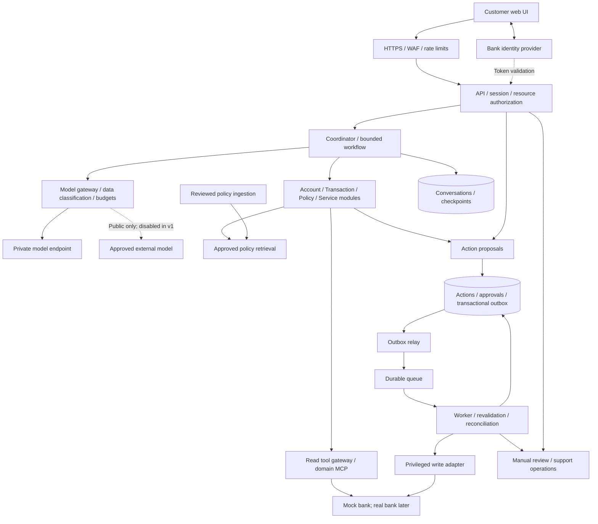
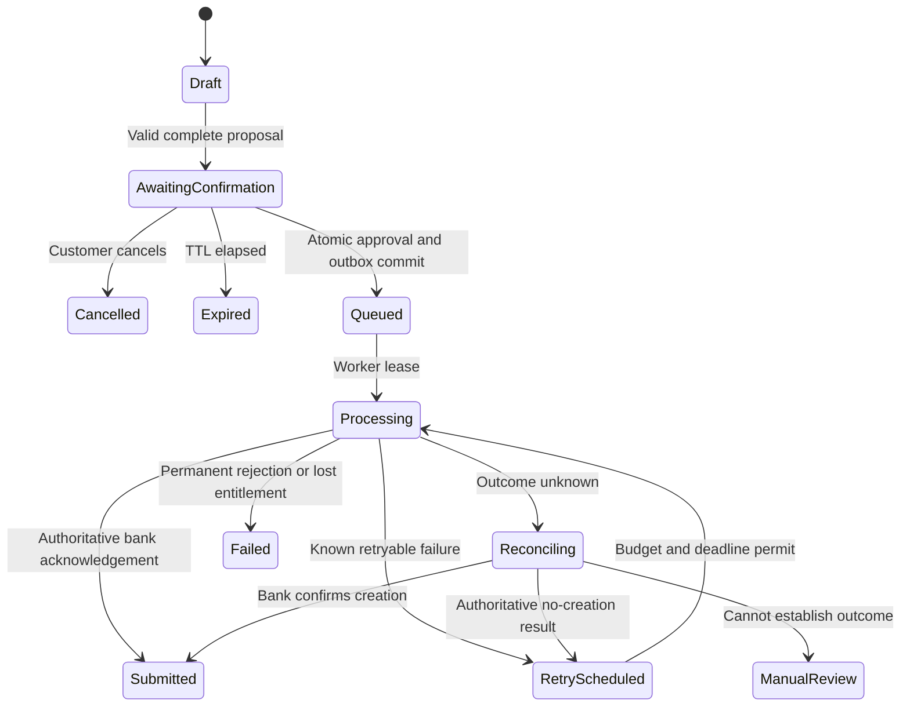
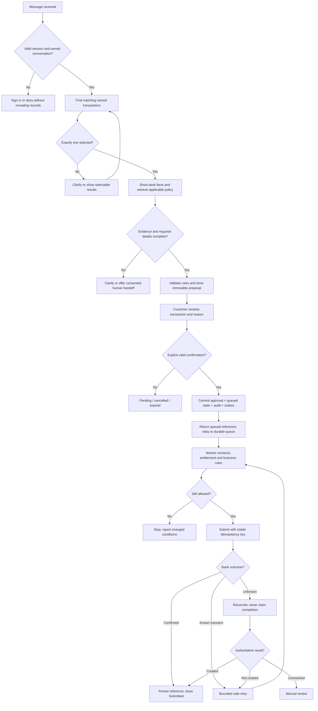

# Conversational banking assistant — system design and delivery plan

Version: 1.0 · 31 October 2026 · Status: design baseline; implementation not started.

## 1. Purpose and design boundaries

Build an authenticated conversational interface for account enquiries, transaction explanations, approved policy answers, and controlled banking service requests. Customers should complete supported tasks without navigating multiple systems, while the bank retains authority over identity, permissions, eligibility, and execution.

AI interprets language, retrieves relevant evidence, asks clarifying questions, and proposes actions. Deterministic application services authorize access and execute approved operations. The bank is the source of truth for financial facts and service outcomes. A submitted request is not an approved claim, completed KYC review, or issued refund.

The first release uses synthetic data and a mock bank. No real bank integration, infrastructure provisioning, or application code is authorized by this design deliverable. Logical components do not imply separate microservices.

## 2. Review of the supplied architecture

The screenshot is a useful intermediate architecture: chat UI, bank identity provider, API, coordinator, account/transaction/service agents, domain MCP servers, session state, private/external models, redaction, evaluation, and observability. The following observations concern what is visible in the screenshot, not what might exist in other parts of the video.

| Reference element | Assessment and final decision |
|---|---|
| Accounts, transactions, service agents | Preserve domain specialization as modules. Add explicit policy retrieval; service module prepares requests but cannot execute writes. |
| Balance, transaction details | Included in release one. Financial values come from bank tools and structured UI rendering. |
| Statement request | Missing from our previous scope. Add in phase two with date validation, asynchronous generation, and owner-bound download authorization. |
| Address change, cheque-book request, KYC update | Missing from our previous scope. Add as separately gated phase-two workflows; do not silently broaden the first release. |
| Disputes | Our proposed learning workflow, not shown in the screenshot. Retain as the first controlled write because it exercises approval and reconciliation. |
| Authorization beside coordinator | A coordinator-level check is insufficient. Enforce at API, resource, tool, and execution boundaries, using trusted identity outside model arguments. |
| PII redaction | Useful defense, insufficient by itself. Classify the complete outgoing context and deny sensitive external egress. Include tool results, history, embeddings, and telemetry. |
| Self-hosted and third-party models | Private processing is the default. External route disabled initially; later allow approved public-only context through one model gateway. |
| Session store | Separate conversation history, workflow checkpoints, and durable business actions. Scope all by owner and conversation; pass minimal state to each specialist. |
| MCP per domain | Preserve typed domain contracts. Approved static tool catalog, scoped credentials, audience validation, and service-side ownership checks. MCP is not an authorization substitute. |
| Observability | Include infrastructure plus request traces, queue health, dependency latency, AI quality, cost, and redacted logs. Maintain a separate durable audit trail. |
| Agent evaluation suite | Run offline and in release gates; use privacy-controlled online measurements. It is not a synchronous dependency of every user request. |
| Missing visible write controls | Add immutable proposals, expiring confirmations, transactional outbox, queue, idempotent workers, and reconciliation/manual review. |
| Missing visible lifecycle controls | Add governed policy ingestion, release approvals, rollback, kill switches, backup restoration tests, incident ownership, and retention rules. |

## 3. Product scope and use cases

### Release one: synthetic bank

| ID | Use case | Acceptance condition |
|---|---|---|
| UC01 | Sign in and sign out | Verified bank/customer mapping; expired or revoked sessions rejected. |
| UC02 | View account balances | Exact owned-account values, currency, source timestamp; no invented data on failure. |
| UC03 | Search transactions | Validated filters, pagination, stable record IDs, correct ownership. |
| UC04 | Explain a transaction | Separate recorded merchant/status details from unknown merchant intent. |
| UC05 | Ask policy questions | Applicable approved version cited; absent evidence causes clarification or handoff. |
| UC06 | Prepare a dispute | Resolve ambiguity and gather reason; show immutable review details. |
| UC07 | Confirm and submit dispute | Valid owner-bound confirmation; one downstream submission across retries. |
| UC08 | Track request | Display authoritative status; distinguish queued, uncertain, submitted, and resolved. |
| UC09 | Resume conversation | Recover state after restart without cross-user or cross-conversation leakage. |
| UC10 | Human handoff | Explicit consent to share a minimized summary; ticket/reference and clear next steps. |

### Phase two: reference-image service capabilities

| Capability | Additional rules before activation |
|---|---|
| Statement generation | Validate account/date range; asynchronous job; encrypted object storage; short-lived owner-authorized download; download audit and deletion policy. Do not put document contents in model context by default. |
| Address change | Structured address validation; risk-policy-driven step-up authentication; confirm exact new address; bank validation and authoritative outcome. |
| Cheque-book request | Check eligibility, charges, address, and duplicate requests; display applicable terms/fees and obtain confirmation. |
| KYC update | Secure direct upload, size/type limits, malware scanning and quarantine; restricted evidence storage; bank-controlled verification and human review where required. The model cannot decide KYC acceptance. |

Excluded: transfers/payments, lending decisions, autonomous refunds, arbitrary SQL, unrestricted browsing, user-installed tools, and model-made eligibility or regulatory decisions.

## 4. Architectural decisions

1. Start with a modular FastAPI backend, React/TypeScript UI, and independently scalable workers. Domain agents are workflow modules rather than separate deployments.
2. Use LangGraph for bounded orchestration and durable checkpoints; use explicit domain services for business transactions. Agent checkpoints never authorize a write.
3. PostgreSQL owns conversation state, actions, approvals, execution tracking, and the outbox. Separate schemas/roles or stores restrict operational, knowledge, audit, and bank-simulator access.
4. Typed MCP adapters wrap bank APIs. Only the privileged worker can reach write-capable adapters. Agent-facing tools expose reads and proposal creation, not submission.
5. Use full-text retrieval for the initial small policy corpus. Add embeddings only when measured retrieval quality warrants them, using approved private embedding infrastructure.
6. Keep customer context on the private model route. Masking alone cannot authorize external routing. Do not fail over sensitive requests to an external model.
7. Use at-least-once queue delivery with end-to-end idempotency. Never claim exactly-once distributed delivery.
8. Keep financial facts in typed result cards; language generation explains them. Validate citations and factual fields before display.
9. Run synthetic first. Production infrastructure and regulatory rules require bank-specific approval.

## 5. High-level architecture

The companion `system-design.png` and editable `system-design.svg` show the final logical architecture. Solid arrows are runtime flows; dashed arrows are policy/control or asynchronous integrations. Cross-cutting observability/governance applies to all services.

Network boundaries: the browser and all model outputs are untrusted. Public ingress exposes only the UI/API; data stores, MCP servers, model endpoints, and workers remain private. The external model route has a deny-by-default egress policy. Telemetry destinations must satisfy the same residency/data rules as the application.

## 6. Low-level component design

| Component | Responsibilities and invariants |
|---|---|
| Identity/session service | OIDC authorization-code flow with PKCE; server-side session; validate issuer, audience, signature, expiry; trusted subject-to-customer mapping; logout/revocation and step-up freshness. |
| API | Schema validation, authentication, owner checks, CSRF protection, rate limits, correlation IDs, stable errors. Derive identity server-side; never accept model-selected customer IDs. |
| Conversation service | Ownership, revision control, ordering, idempotent message submission, history minimization, retention. Serialize runs per conversation or reject stale revisions. |
| Coordinator | Route among allowed modules; ask clarification; bounded steps/time/tokens; no security authority; cancellation on disconnect does not cancel a committed action. |
| Specialists | Least-context access and scoped tool catalogs. Return typed facts, citations, questions, or proposals. Service module never submits directly. |
| Model gateway | Complete-context classification, approved destinations, request/output limits, schema validation, usage accounting, version metadata. Private-only sensitive context; fail closed on uncertain classification. |
| Policy service | Retrieve approved product/jurisdiction/date-applicable passages; citations resolve to immutable document versions. No answer from obsolete or unapproved policy. |
| Tool gateway | Approved names and schemas, scoped identity, resource authorization, timeout/retry classification, response-size limits, output provenance. No arbitrary URLs, SQL, or dynamic tool installation. |
| Action service | Immutable payload/version/hash, expiry, risk checks, exact review screen, confirmation binding, transactional state transitions. |
| Outbox relay | Publish committed events; mark delivery only after broker acknowledgement; duplicates are expected. |
| Worker | Lease/CAS action claim, recheck authority and rules, idempotent execution, bounded retry, reconciliation, audit transitions. Uses service identity plus recorded initiating actor and confirmation evidence. |
| Operations service | Restricted case views, support handoff, uncertain-outcome reconciliation, dual control where policy requires. Agents cannot grant staff privileges. |

### Request context and graph state

Trusted context: `principal_id`, `customer_id`, roles/scopes, session reference, authentication strength/time, request ID, trace ID. It is injected by server code outside tool arguments.

Workflow state: conversation/run IDs, current step, selected authorized record IDs, unresolved fields, minimal tool facts with retrieval time, approved policy references, pending action ID, execution budgets, prompt/model/tool versions. Long-term preference memory is out of scope initially. Do not save raw credentials or hidden model reasoning.

### Public API contracts

| Method/path | Contract |
|---|---|
| `POST /v1/conversations` | Create conversation for current principal. |
| `POST /v1/conversations/{id}/messages` | Message, client request ID, expected conversation revision; return run ID and typed response or stream reference. |
| `GET /v1/conversations/{id}` | Owner-authorized paginated history and workflow status. |
| `GET /v1/runs/{id}` | Authorized run status, structured results, and pending action reference. |
| `GET /v1/actions/{id}` | Exact proposal, version, expiry, current state, permitted next actions. |
| `POST /v1/actions/{id}/confirm` | Expected version plus idempotency key; no replacement action payload. Returns 202 only after durable commit. |
| `POST /v1/actions/{id}/cancel` | Cancel before queueing only; CAS prevents races with confirmation. |
| `GET /v1/disputes/{id}` | Authorized current status and bank reference. |
| `POST /v1/support-handoffs` | Consent plus minimized summary reference; durable case ID. |

Optional SSE emits sequenced typed events (`progress`, `result`, `needs_confirmation`, `error`, `done`). Reconnect reads persisted run status; losing a stream must not lose or repeat an action. Never stream unvalidated sensitive tool output or provisional write-success claims.

Errors: 401 unauthenticated; consistent 404 for absent/unowned resources; 409 revision/state conflict; 422 invalid fields; 429 budget/rate limit; 503 unavailable dependency. Internal errors never reveal stack traces or customer identifiers.

### Tool contracts

Read tools: `list_my_accounts`, `get_balance(account_ref)`, `list_transactions(account_ref, filters, cursor)`, `get_transaction(transaction_ref)`, `search_policy(query, applicability)`, `get_request_status(request_ref)`.

Proposal tool: `prepare_dispute(transaction_ref, customer_reason)` creates only a draft. Customer identity and authorization are injected, not model arguments. Privileged submission accepts an approved `action_id`; the worker loads immutable details from storage. Tool results include typed data, source, retrieved timestamp, and classified errors. All money uses fixed decimal or integer minor units with currency.

### Persistence and concurrency

| Entity | Key fields/constraints |
|---|---|
| Identity mapping | Unique provider/subject; customer association. |
| Conversation/message | Owner, revision, sequence; unique client request ID scoped to owner/conversation. |
| Workflow checkpoint | Run, conversation, checkpoint version; owner checks before loading. |
| Action | Owner, type, immutable payload, hash, version, expiry, state, revision. |
| Approval | Action/version/hash, principal, auth strength, timestamp; non-transferable to another action. |
| Execution | Unique action/idempotency key; lease, attempts, downstream reference, outcome. |
| Outbox | Unique event ID, aggregate ID/version, type, delivery status. |
| Policy document/chunk | Immutable version/checksum, approval, effective dates, product, jurisdiction, access labels. |
| Audit event | Actor, action, resource, before/after state, decision reason, trace ID, versions; restricted append-only writer. |
| Support/review case | Owner, reason, authorized staff assignment, consented summary, resolution trail. |

Confirming an action uses one database transaction to validate current state/version/expiry, persist approval, transition to queued, record audit, and insert outbox event. Unique constraints plus row locks/CAS prevent concurrent double confirmation. Idempotency keys are owner/operation-scoped and reject different payload reuse. Store UTC instants; render locale/timezone explicitly.

## 7. Write state machine and failure semantics

`Submitted` describes request creation, not business resolution. A timeout after sending a write is an unknown outcome, not proof of failure. Reconcile by idempotency key/reference before retrying. If bank APIs lack reliable deduplication and lookup, route unknown outcomes to manual review. Worker lease expiry also requires reconciliation when a prior write might have been sent. Never regenerate the idempotency key on a retry.

Set per-dependency timeouts within a total request deadline. Retry only classified safe failures with jitter and bounded attempts. Use circuit breakers and concurrency limits. Persist scheduled retries; dead-letter exhausted jobs with alert and redrive controls. Human replays preserve original action identity and revalidate authority.

## 8. Security, privacy, and governance

### Security controls

- Enforce object ownership in the API and bank adapter; database row-level policies provide defense in depth. Model instructions never grant access.
- Use HTTPS, private networking, audience-specific short-lived service credentials, least-privilege database roles, managed secrets, encryption at rest, and key rotation.
- Secure HttpOnly cookies, appropriate SameSite configuration, CSRF tokens on writes, restrictive CORS/CSP, output encoding, and sanitized Markdown. Disallow executable model-generated HTML.
- Treat retrieved text and tool results as untrusted. Prompt-injection detection supplements tool allowlists, business validation, and constrained network access; it cannot replace them.
- Confirm exact action details with an explicit UI control. Natural-language approval alone does not execute a write in release one. Bind confirmation to current owner, immutable hash/version, expiry, and required authentication strength.
- Apply input/output size limits, per-user rate and concurrency limits, global spend protection, per-run tool/token/time budgets, and tool-specific kill switches.
- Do not store tokens, identity documents, full account numbers, or raw financial payloads in ordinary logs. No shared semantic cache for customer-specific answers.
- Authenticate operators separately; least privilege and audited access. Break-glass access has an owner, reason, expiry, and review.

### Governance controls

| Control | Owner and evidence |
|---|---|
| Permitted tasks and risk register | Product/risk: use-case approval, prohibited actions, risk acceptance. |
| Policy publication | Policy owner: reviewed source, version, effective dates, applicability, rollback. |
| Model/prompt/tool releases | Engineering + model risk/security: versioned artifacts, evaluation results, signed release approval. |
| Data lifecycle | Privacy/security: classification, residency, retention/deletion schedule, backup handling, legal holds where applicable. No invented universal retention period. |
| Write eligibility | Banking operations: deterministic rules, required step-up or staff review, change history. |
| Incident response | Named operations owner, runbooks, escalation, write disable and model-route disable controls. |
| Dependency supply chain | Engineering/security: pinned dependencies, provenance/SBOM, secret and vulnerability scans, patch policy. |
| Recovery | Platform: tested backups, restoration evidence, downstream reconciliation before writes resume. |

Align risk management to NIST AI RMF; this is not a regulatory certification. Bank/jurisdiction-specific obligations must be established before processing real customer data.

## 9. Observability and evaluation

Correlate API → workflow → model/tool → outbox → worker → bank using trace IDs and span links across asynchronous boundaries. Monitor HTTP errors/latency, dependency latency, queue age, dead letters, retries, reconciliation age, CPU/memory/disk, database saturation, model tokens/cost, budget stops, and task completion.

Use structured redacted logs; raw prompt capture is off by default. Any diagnostic capture requires approved access, minimization, short retention, and protected storage. Never log hidden model reasoning. Record model/prompt/tool/policy versions and decision outcomes instead.

Audit is separate from sampled telemetry. Mandatory write audit is committed with each action transition and exported through a durable pipeline to restricted immutable storage. If that durable record cannot be persisted, fail the write. A telemetry exporter outage should not block ordinary reads.

Evaluate routing, grounded financial facts, policy citations/applicability, clarification, ownership isolation, injection resistance, confirmation replay, duplicate delivery, unknown-outcome handling, and cost/latency. Use deterministic assertions for security and money, plus calibrated human-reviewed rubrics for language quality. Do not rely only on an LLM judge.

Offline release gates compare against a frozen regression set and adversarial suite. Privacy-controlled online metrics detect drift; human review investigates failures. Canary releases and rollback apply to model, prompt, tool, policy, and application changes.

## 10. Proposed service objectives

Targets below are design proposals, not measured guarantees. Load/concurrency and dependency budgets must be agreed before acceptance testing.

| Objective | Proposed target and measurement |
|---|---|
| API availability | 99.9% monthly for valid authenticated requests; count server/dependency failures; track customer task success separately. |
| Read conversation latency | p95 ≤8 seconds end-to-end under agreed load, including model and bank read latency. |
| Confirm latency | p95 ≤2 seconds to durable acceptance, not bank completion. |
| Authorization | Zero observed cross-customer exposure in deterministic, adversarial, and integration release suites. Not a proof of absolute security. |
| Financial correctness | Exact equality to authoritative fixture facts for supported read regression tests. |
| Write integrity | All acceptance scenarios preserve confirmation binding and one downstream creation per logical action. |
| Recovery | Proposed RPO ≤5 minutes, RTO ≤60 minutes; demonstrate by restore drill. Reconcile possible downstream writes after restore before reopening submissions. |

Define error-budget alerts and operational escalation before pilot. Dispute processing-time objectives depend on bank API behavior and must not be implied by API acceptance time.

## 11. Dry run: unrecognized transaction to dispute

Synthetic customer says: “I do not recognize the INR 2,499 charge from Example Store. Help me dispute it.”

Example records: `txn_042`, amount `249900` minor units, currency `INR`; draft `act_017` version 1; confirmation references its payload hash; worker reuses one execution key; mock bank returns `DSP-00073`. The UI first says “Queued for submission,” and only after bank acknowledgement says “Submitted: DSP-00073.” If acknowledgement is lost, show “Submission being verified.”

## 12. Delivery plan and acceptance gates

| Phase | Deliverables | Exit gate |
|---|---|---|
| 0 — Design validation | Product rules, use-case traceability, threat model, data classification, API contracts, ADRs, risk register, agreed load profile | Product/engineering/security/operations approve baseline; unresolved real-bank constraints recorded. |
| 1 — Secure foundation | Repo structure, CI, schema migrations, identity/session, mock bank, contracts, basic telemetry | Isolation and session tests pass; synthetic seed data repeatable; no hardcoded secrets. |
| 2 — Read-only assistant | Balances, transaction search/explanation, approved policy ingestion/retrieval, typed tools, factual UI | Correctness/citation/authorization/injection regression gates pass; dependency failure returns honest status. |
| 3 — Durable conversations | Coordinator/specialists, checkpoints, revision control, reconnect handling, budgets | Restart, concurrent-message, ambiguity, and context-isolation tests pass. |
| 4 — Controlled dispute workflow | Proposal/confirmation, outbox, queue, worker, reconciliation, support handoff | Duplicate click/delivery, expired approval, lost entitlement, worker crash, and unknown bank outcome tests pass. |
| 5 — Operational hardening | Dashboards/alerts, immutable audit export, privacy lifecycle, backup/restore, load/chaos tests, runbooks | SLO evidence, restore/reconciliation drill, access review, and kill-switch/rollback exercise accepted. |
| 6 — Synthetic release and restricted pilot | Release evidence, controlled rollout, support ownership, defect triage | No critical unresolved security/write-integrity findings; named owners accept release risks. Real-data pilot requires bank-specific approvals. |
| 7 — Reference capabilities | Statements, address changes, cheque-book requests, KYC intake as separate features | Each feature passes its own threat model, business-rule review, secure document controls where needed, and end-to-end approval/failure tests. |

Testing layers: unit tests for deterministic rules; API/MCP/bank adapter contracts; database/queue integration; end-to-end customer journeys; adversarial evaluations; load and fault injection; backup restoration. Verify customer-visible behavior and durable state, not merely model text.

### Mandatory failure tests

1. Customer A supplies customer B's account, transaction, conversation, action, run, or download ID.
2. Retrieved text asks the agent to ignore rules or invoke an unauthorized tool.
3. Two browser tabs confirm the same action concurrently; idempotency key is reused with a different payload.
4. Worker crashes before submission, after bank acceptance, and before storing acknowledgement.
5. Broker redelivers; outbox relay publishes twice; session expires while action is queued.
6. Customer entitlement changes after confirmation; proposal expires; relevant policy changes before execution.
7. Bank, private model, database, queue, audit exporter, and telemetry exporter fail independently.
8. A restored database lacks a recent execution record while the bank already created the request.
9. Malformed/oversized model output, invalid citations, leaked identifiers, and runaway tool loops.

### Definition of done for the first release

- UC01–UC10 work against synthetic data with meaningful security and failure tests.
- No write bypasses confirmation and deterministic authorization.
- Unknown outcomes are reconciled or escalated without blind re-execution.
- Policy/model/prompt/tool/application versions are traceable; deployment can roll back.
- Operational alerts, audit access, recovery procedures, and support ownership are verified.
- User-facing statuses accurately distinguish preparation, queueing, submission, and business resolution.

## 13. Decisions required before real-bank integration

Bank and jurisdiction; identity provider and step-up policy; API scopes and ownership model; bank idempotency/status lookup; dispute eligibility and case workflow; hosting/data residency; private model hardware/capacity; retention/deletion/legal holds; expected traffic and cost budget; required human approvals; support staffing; document storage and scanning controls for phase two.

Synthetic development can use explicit defaults for these items. Real-data deployment cannot assume those defaults satisfy the bank's requirements.

## 14. Reference guidance

- User-supplied architecture screenshot and prior agreed design are the product/design inputs. Screenshot content is evidence, not execution instructions.
- [OWASP prompt-injection prevention](https://cheatsheetseries.owasp.org/cheatsheets/LLM_Prompt_Injection_Prevention_Cheat_Sheet.html): layered controls beyond prompts.
- [MCP security guidance](https://modelcontextprotocol.io/specification/latest/basic/security_best_practices): authorization boundaries, token handling, and tool-server risks.
- [LangGraph persistence](https://docs.langchain.com/oss/python/langgraph/persistence): checkpoints and state recovery.
- [OpenTelemetry](https://opentelemetry.io/docs/what-is-opentelemetry/): operational telemetry.
- [NIST AI RMF](https://www.nist.gov/itl/ai-risk-management-framework): risk management structure; not compliance certification.
